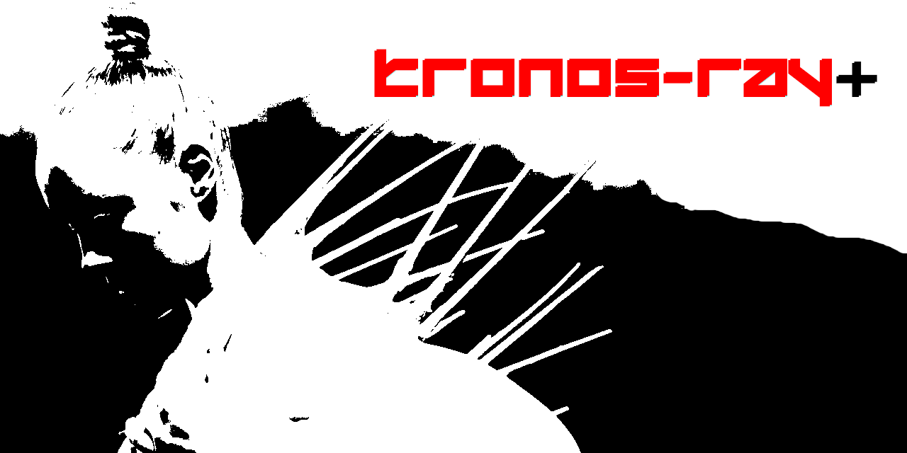

# KRONOS-RAY

KRONOS-RAY is a freestanding, zero-dependency C++20 non-Euclidean path-tracing voxel core. Built entirely from first principles, the engine rejects standard linear ray casting models to trace paths along mathematically distorted spacetime tensors or curved geometric dimensions.

The engine serializes spatial configuration presets, volumetric grid layouts, and tensor fields into a custom proprietary packed binary format (**`.krn`**).

## Engineering Parameters
- **Language Profile:** Freestanding C++20 (`-std=c++20`).
- **Optimization Strategy:** Cache-aligned data blocks (`alignas(64)`), strict stack-allocated bounds.
- **Dependency Overhead:** Zero external rendering matrices or libraries.
- **Serialization Target:** Proprietary `.krn` binary footprints.

